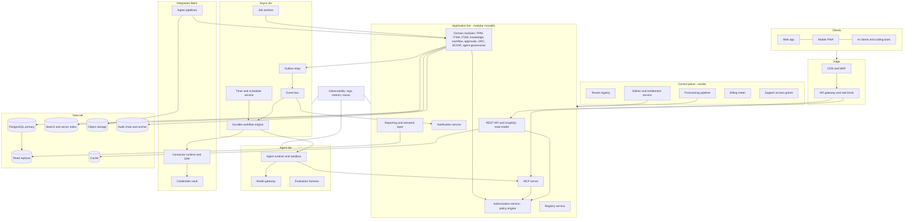

# 14. Production architecture

The production system is a modular monolith on PostgreSQL with a durable workflow engine, an outbox-fed event bus, a policy-based authorization service and a governed agent runtime, deployed from one set of infrastructure-as-code modules to four tenancy models.

Scope: this section turns the database-free prototype (build out_v16b) into a production reference architecture. Section 13 covers selling and setting up a tenant. Section 15 covers the build handoff. Section 16 lists open decisions. Dollar figures are approximate, at AWS list prices before discounts, and must be validated before they reach a quote.

## 14.1 What the prototype proves and what it fakes

The prototype is a single HTML build with in-memory registries. These numbers come from build out_v16b and are the sizing baseline for the production schema.

| Prototype fact | Value | Production consequence |
|---|---|---|
| Screens | 169 | Each screen maps to one or more API resources and a permission rule |
| Modules on the module map | 123 (39 live, 84 proposed) | Modules become packages inside the monolith |
| Module flows | 745 (535 live, 210 proposed) | Each flow is a typed interface: event, batch, human or api |
| Data model tables | 274 registered (236 in the entity atlas, 94 proposed) | Tables are generated from the registry, not hand-written |
| Field metadata | 2,157 fields classified in the atlas; 1,076 field entries in the data model carry no classification or authority | Registry seed must classify every field before first load; a gate check fails the load otherwise |
| Field classes (classified) | 1,693 internal, 178 personal, 52 confidential, 24 restricted | Drives masking, encryption and export rules |
| Field authority (declared) | 1,911 platform, 30 external, 6 shared | External and shared fields need connector mappings and conflict rules |
| Processes in the library | 246 | Seed content, versioned per release |
| Workflows | 311 definitions; node types: human 682, approval 345, auto 573, agent 190, trigger 311, end 317, decision 23, wait 5, assessment 4, parallel 3, subflow 3, loop 1 | The workflow engine must support all 12 node types |
| Event catalog | 70 events from 19 modules, 25 rules, all owned | Event contract becomes the outbox schema |
| Permission model | 222 rules (152 screen, 28 section, 42 entity), 43 field rules, 17 roles, 10 approver groups; 25 of 274 entities have an entity rule | Row and attribute tiers are the largest build gap |
| Metrics | 381 | Semantic layer seed |
| AI agents | 16 registered, 5 through the gateway | Agent runtime and model gateway |
| MCP tools | 10 (search_registry, get_entity, check_reuse, get_policy, validate_manifest, request_exception, list_connectors, run_conformance, run_feature_contract, find_owner) | Registry-side tools exist; record-side tools do not |
| Connectors | 13 listed, all simulated | Connector SDK and vault |
| Foundation workbook | 11 sheets | Import pipeline |
| Persistence | STORE backend is memory; 2 entities defined (event_definition, event_rule) | The whole entity store |

Everything that touches persistence, identity, connectors, models and timers is simulated and labeled so in the prototype. This section specifies the real versions.

## 14.2 Reference architecture

Text form for reviewers who cannot render the diagram:

| Layer | Components | Talks to | State |
|---|---|---|---|
| Edge | CDN, WAF, API gateway, rate limiter | Clients, application tier | None |
| Application | API, MCP server, authorization, domain modules, registry, notification, reporting | Data tier, outbox | Stateless processes |
| Async | Workflow engine, scheduler, event bus, outbox relay, job workers | Application, agents, fabric | Workflow history, timer table, topic offsets |
| Agent | Agent runtime, model gateway, evaluation harness | MCP server, model providers | Run records |
| Fabric | Connector runtime, vault, ingest pipelines | External systems | Sync state, quarantine |
| Data | PostgreSQL, replicas, search, cache, object storage, audit chain | Everything above | All durable state |
| Control plane | Tenant registry, provisioning, entitlements, meter, support grants | Per-tenant stacks | Tenant metadata only, no customer data |

## 14.3 Tenancy model and deployment paths

Decision D-R16-01 stands: pooled SaaS with per-tenant schema and per-tenant encryption key is the default. All four paths share the same container images, infrastructure modules and migration set, so there is one product and one test matrix.

| Path | Isolation | Who operates | Typical customer | Priced as |
|---|---|---|---|---|
| Pooled SaaS | Per-tenant schema, per-tenant key, shared compute with quotas | Vendor | Midsize, default | Subscription |
| Dedicated stack, vendor AWS organization | Own VPC, own database cluster, own keys | Vendor | Customers that need isolation or custom residency in a vendor region | Premium subscription |
| Dedicated stack, customer AWS account | Customer owns the account; vendor operates with time-boxed just-in-time access | Vendor, with customer controls | Regulated or procurement-bound customers | Priced add-on |
| Private VPC or on-premises container install | Customer environment | Customer, vendor supports | Exception only | Separate support policy |

Tenant boundary: tenant record, schema, key, subdomain, identity provider connection, region.

Pooled design rules:

1. Every table in the tenant schema carries `tenant_id`, even though the schema already isolates. Row-level security keys on `tenant_id` as a second wall.
2. The application connects with a role that has no superuser rights. A session variable `app.tenant_id` is set per request and checked by every policy.
3. Quotas per tenant cap connections, statements per second, storage, event rate and agent spend, so a noisy neighbor degrades itself first.
4. A tenant moves from pooled to dedicated by restoring its backup into a new stack; the schema version must match the release.
5. Schema-per-tenant is practical to about 200 tenants on one cluster. Past that, shard by cluster: the tenant registry records the cluster for each tenant.

Control plane versus data plane: the vendor control plane holds tenant metadata only. It never stores customer records. Connectors run in the tenant data plane and credentials stay in the tenant key store.

## 14.4 System of record database

Recommendation: PostgreSQL 16 or later (Amazon Aurora PostgreSQL or RDS for the managed paths; plain PostgreSQL in container for private installs).

| Option | Pros | Cons | Fit |
|---|---|---|---|
| PostgreSQL with row-level security, JSONB, partitioning | One engine for relational, flexible fields, full text and vectors; row-level security as a backstop to the policy engine; mature backup, replicas and tooling; runs the same on all four deployment paths; no license cost | Vertical write scaling; schema-per-tenant needs migration tooling at scale | Recommended |
| MySQL or MariaDB | Familiar, widely hosted | Weaker JSON indexing, no native row-level security, weaker partial and expression indexes | Reject |
| SQL Server | Strong tooling, temporal tables built in | License cost on every deployment path, weak fit for private installs and containers | Reject |
| DynamoDB or another key-value store | Effortless scale | The model is relational (745 flows, 274 tables, 707 reference fields); ad hoc reporting and joins are central; vendor lock-in blocks private installs | Reject |
| Distributed SQL (CockroachDB, YugabyteDB) | Horizontal write scaling, multi-region | Operational cost and complexity unneeded at thousands of users and millions of records | Revisit if one tenant exceeds 50 million rows in a hot table |
| Document database (MongoDB) | Flexible schema | Field-level classification, referential integrity and audit are the product; documents push them into application code | Reject |

Why: the scale target is thousands of users, millions of records and hundreds of events per second at peak. A single well-indexed PostgreSQL primary with replicas carries that with headroom. The product's distinguishing feature, governed metadata per field, is easier to enforce in a relational schema.

Standard configuration:

1. Primary plus one synchronous standby in a second availability zone; two read replicas for reporting and search indexing.
2. Partition high-volume append tables (audit_event, event_log, step_run, sync_run, notification, metric_series) by month on the timestamp, with a retention job per partition.
3. Use JSONB only for tenant-defined extension fields and for payload columns on logs. Anything queried in a filter, join or permission rule is a real column.
4. Connection pooling through PgBouncer in transaction mode; the tenant variable is set per transaction.
5. Extensions: pg_trgm, pgvector, pg_partman and pgaudit. Timers are rows, not a database scheduler extension (see 14.10).

## 14.5 Entity store design mapped from the registry

The registry (ATLAS and DATAMODEL in the prototype) is the source from which tables, API resources, forms, permissions and documentation are generated. Hand-written tables are blocked by the Feature Contract rule 2 gate.

Core tables:

| Table | Purpose | Key columns |
|---|---|---|
| entity_def | One row per entity: id, label, domain, owner module, steward, status (canonical, proposed, duplicate, fixed), retention, version | entity_id, version |
| field_def | One row per field: type, required, classification (public, internal, confidential, restricted, personal), authority (platform, external, shared), direction, conflict rule, freshness class (live, near-live, hourly, daily), masking rule, ref target | entity_id, field_k |
| record tables | One physical table per canonical entity, generated from entity_def | id, number, tenant_id, created_at, updated_at, deleted_at, version, ext JSONB |
| record_version | Append-only history of every change: before, after, actor, source, event id | record_id, version |
| audit_event | Append-only audit chain (see 14.20) | seq, prev_hash, hash |
| event_log | Append-only business events as emitted (EVENTS contract) | event_id, type, payload JSONB |
| outbox | Transactional outbox rows awaiting relay | event_id, status, attempts |
| baseline | Temporal history for plans, budgets and maturity targets | record_id, valid_from, valid_to |
| shared children | assignment, comment, attachment, audit_event (one implementation each, per the entity catalog decision) | parent_type, parent_id |

Design rules:

1. Soft delete: `deleted_at` plus a purge job that honors retention and legal hold. Hard deletes are limited to erasure requests, which write a tombstone to the audit chain.
2. Versioning: optimistic concurrency through `version`; every update writes a `record_version` row in the same transaction.
3. Temporal tables for baseline history: schedule baselines, budget baselines and maturity targets use a valid-time range so a report can be run as of any date. Use range types with exclusion constraints to prevent overlap.
4. Cross-module access is by reference id, never by copy; a cached projection is allowed only with a declared refresh.
5. Entity ids are singular snake_case; every entity has an `id` and a human `number`.
6. Extension fields added by a tenant live in `ext` JSONB with a registered field_def, so classification and masking still apply.
7. Schema changes run as versioned migrations generated from registry diffs, reviewed by the data council, applied tenant by tenant.
8. The 1,076 unclassified field entries in the prototype data model are a release blocker: the migration generator refuses a field with no classification and no authority.

Entity ownership rule from the entity catalog applies: one owner module writes the canonical record. The five fixes (skill versus skill_claim, project_task versus wbs_line, contract split, one approval entity, shared child entities) are applied in the registry seed before the first tenant is created.

## 14.6 Search

| Option | Pros | Cons | Recommendation |
|---|---|---|---|
| PostgreSQL full text plus pg_trgm plus pgvector | No extra service; transactional with the data; permission-aware by joining the same row policies; one backup | Weaker ranking, faceting and typo tolerance than a dedicated engine; heavy search load competes with transactional load unless routed to a replica | Recommended for the first release |
| OpenSearch (managed or container) | Strong relevance, facets, highlighting, scale-out | A second datastore to secure, back up and keep consistent; row-level permissions must be re-implemented as filters; extra cost per tenant | Add when a tenant exceeds about 10 million searchable documents or needs faceted search over knowledge at scale |
| Vector database (Pinecone, Qdrant) | Purpose-built | Another vendor and data copy for data that carries classification | Reject |

Rules:

1. Search results are filtered by the same authorization service as reads. A hit the caller cannot read is never returned or counted.
2. Search provider contract (SEARCHX in the prototype) becomes an indexer per module, fed from the event bus.
3. Embeddings are computed asynchronously, through the model gateway, only for fields classified internal or lower unless the tenant opts in for confidential content. Restricted and personal fields are never embedded.
4. Search is replica-routed; staleness target is under 30 seconds.

## 14.7 Cache, object storage

| Concern | Choice | Notes |
|---|---|---|
| Cache | Redis-compatible (ElastiCache or container Redis) | Session data, rate-limit counters, permission decision cache keyed by (principal, policy version), idempotency keys with TTL. Never the source of truth. |
| Object storage | S3 (or S3-compatible on private installs) | Attachments, import files, report exports, evidence packs, model-gateway request archives. Prefix per tenant, SSE-KMS with the tenant key, versioning on, object lock for audit exports. |
| Antivirus and content checks | Scan on upload before the object becomes visible | Quarantine prefix for failures |
| CDN | Static assets and signed download URLs | Short-lived signed URLs, tenant-scoped |

Cache invalidation: the permission cache is keyed by policy version; a policy change bumps the version and the cache empties by key change rather than by scan.

## 14.8 Event bus and outbox

The EVENTS contract in the prototype is the schema. An event definition is `{id, label, module, owner, fields[{name, type, ref}]}`. An emitted event is `{eventId, id, label, payload, source, actor, at, outcomes[]}`. Rules are `{id, when, if, then[]}`. The prototype keeps 500 events in memory; production keeps all of them.

Pattern:

1. A domain write and its event insert into `outbox` happen in one database transaction. No event without the data change, no data change without the event.
2. A relay process reads the outbox in order per aggregate, publishes to the broker, and marks the row sent. At-least-once delivery; consumers deduplicate on `eventId`.
3. Topics are named `<tenant>.<domain>.<event>`; the 70 catalog events map to about 19 topic groups (one per owning module).
4. Rules ("downstream integrations are rules, not code", Round 15 decision) are evaluated by a rules consumer that runs the `if` expression and the `then` actions, writes an outcome row, and retries with backoff. Failures go to a dead-letter topic with a replay action.
5. Event catalog changes are versioned. A breaking field change needs a new event version and a deprecation window.

| Broker option | Pros | Cons | Recommendation |
|---|---|---|---|
| PostgreSQL outbox plus LISTEN/NOTIFY and a polling relay, consumers in-process | Zero new infrastructure; exact transactional semantics; fits hundreds of events per second | Fan-out to many external subscribers is limited; no replay window beyond the table | Recommended for first release and for private installs |
| Amazon SQS and SNS (or EventBridge) | Managed, cheap, durable, simple fan-out | Ordering needs FIFO queues; no replay beyond DLQ; AWS-only | Recommended broker once external subscribers or webhooks need fan-out on AWS paths |
| Apache Kafka (MSK) | Replay, high throughput, ecosystem | Operational weight and cost far above the need | Reject at this scale |
| NATS JetStream | Light, replayable, runs anywhere including private installs | Smaller ecosystem; team skills | Alternative for private installs if needed |

Decision: relay interface is a port with two adapters (Postgres-native and SQS/SNS), so the same code runs on all four deployment paths.

## 14.9 Durable workflow orchestration

The prototype has 311 workflow definitions with 12 node types and a run record model (workflow_instance, step_run, workflow_definition). Production needs durable execution: runs survive deploys and crashes, timers fire days later, and every step is audited.

| Option | Pros | Cons | Recommendation |
|---|---|---|---|
| Temporal (self-hosted or cloud) | Mature durable execution, signals, timers, child workflows, versioning, strong testing story | Another cluster to run and secure; determinism rules for workflow code; Temporal Cloud is a vendor dependency and a data-residency question; private installs need self-hosting | Recommended if the team accepts the operating cost; strongest fit for long-running human and agent steps |
| AWS Step Functions | Managed, no servers, visual | AWS only (breaks private and on-premises path); state size and history limits; 311 definitions as generated state machines is awkward; per-transition cost | Reject as the core; acceptable for connector job fan-out on AWS paths |
| In-house engine on PostgreSQL (definition interpreter, run and step tables, timer table, worker leases with SKIP LOCKED) | No new infrastructure; definitions are data (the prototype already stores them as nodes and edges); runs are queryable with the rest of the data; works on every deployment path; one backup | We own correctness: retries, timers, versioning, concurrency, replay | Recommended for first release |

Recommendation: build the interpreter in-house on PostgreSQL, behind a `WorkflowEngine` port, for the first release. Reasons: the definitions are already data interpreted by the prototype runtime; the 12 node types are simple compared with general-purpose code workflows; the private install path forbids a hard cloud dependency; hundreds of events per second is within a Postgres queue. Keep the port clean so Temporal can replace the executor if run volume or complexity exceeds the in-house design. Review point: end of phase 3 (see 14.25).

Node type mapping:

| Prototype node type | Count in 311 definitions | Production semantics |
|---|---|---|
| trigger | 311 | Event subscription, schedule, manual start, or API call; creates a workflow_instance |
| auto | 573 | Deterministic action: set field, create record, call connector, send notification; idempotent with a key `instance:step` |
| agent | 190 | Hands a task to the agent runtime with tool allow list, budget and timeout; result is recorded; confidence below threshold routes to a human gate |
| human | 682 | Creates a work item assigned to a group queue; completes on user action or timeout |
| approval | 345 | Creates an approval for an approver group (never an individual); segregation of duties and delegation limits checked by the authorization service; quorum rules; escalation timer |
| decision | 23 | Evaluates a decision table or expression over the instance variables; branch recorded with the rule that fired |
| wait | 5 | Parks the instance until a signal, an event or a timer |
| assessment | 4 | A questionnaire or checklist step scored against thresholds |
| parallel | 3 | Fork and join with a join policy (all, any, count) |
| subflow | 3 | Starts a child instance and waits; child failure policy configurable |
| loop | 1 | Bounded iteration with a maximum count |
| end | 317 | Terminal state with outcome |

Run semantics:

1. Each step execution is a row in `step_run` with attempt number, started, finished, outcome, error and the actor (human, agent id, system).
2. Workers lease runnable steps with `FOR UPDATE SKIP LOCKED`; a lease expires if the worker dies.
3. Definitions are versioned; an instance pins the definition version it started on; migration of in-flight instances is an explicit, approved operation.
4. Tenant overlays (section 13) are resolved at instance start: effective process equals base plus the tenant's active overlay at that moment, pinned for the instance.
5. Human and approval steps never time out into an approval. Timeouts escalate or reassign.
6. Compensation steps are explicit nodes, not implicit rollback.

## 14.10 Timers and scheduler

Timers are rows, not cron entries, so they are tenant-scoped, auditable, pausable and survive restarts.

| Timer class | Examples | Mechanism |
|---|---|---|
| SLA timers | Response and resolution clocks with business calendars, pause conditions, breach warnings at 75 and 90 percent | `timer` rows with due_at computed from calendar; a due-timer sweeper fires an event `sla.warning` or `sla.breached` |
| Workflow timers | Wait nodes, approval escalation, reminder cadence | Same table, target is a workflow_instance and step |
| Report schedules | Daily, weekly, monthly report builds and distribution | Schedule rows expand to occurrences; the worker builds from a replica and stores the artifact in object storage |
| Exercise reminders | BC/DR exercise notice windows by tier (the prototype tiers use 21, 14, 10 and 5 days notice) | Recurring schedule per plan; notification service sends |
| Deferred notifications | Digest windows, quiet hours, defer-until | Notification rows with `send_after` |
| Recertification campaigns | Access reviews, owner and backup confirmations, policy attestations | Campaign record creates one work item per subject; reminders and escalations by timer; close-out report |
| Connector schedules | Daily, hourly, near-live polls | Schedule rows with backoff and a per-source rate limit |
| Retention and purge | Partition drops, soft-delete purge, legal-hold checks | Maintenance jobs |

Implementation: one `timer` table (tenant_id, kind, due_at, payload, status, lease) indexed on `(status, due_at)`; sweepers run per tenant fairly (round robin) with a cap per tick. Accuracy target: fire within 5 seconds of due time for SLA and approval timers; within 60 seconds for the rest. If the Temporal option is adopted later, workflow timers move to it and this table keeps the rest.

## 14.11 Application server and API

Modular monolith first. One deployable, many bounded modules, enforced module boundaries (dependency rules checked in CI), one database per tenant schema. Extract a service only when a module has a distinct scaling or security profile: the first candidates are the agent runtime, the connector runtime and the reporting service, which are already separate tiers in 14.2.

| Option | Pros | Cons | Recommendation |
|---|---|---|---|
| Modular monolith (TypeScript on Node, or Java/Kotlin) | One deploy, simple transactions with the outbox, fast refactoring, small team | Needs discipline on module boundaries | Recommended |
| Microservices from day one | Independent scaling | Distributed transactions, 123 modules of coordination, team too small | Reject |

API style:

| Option | Pros | Cons | Recommendation |
|---|---|---|---|
| REST with OpenAPI generated from the registry | Predictable, cacheable, easy for connectors, MCP and third parties; contract is the registry | Over-fetching on composite screens | Recommended as the public and write API |
| GraphQL | One round trip for composite screens such as Service 360 and Person 360; field-level selection fits field masking | Authorization per field and query cost control add work; caching harder | Recommended as a read-only composition layer for the web client, with persisted queries and depth and cost limits |
| tRPC | End-to-end types for a TypeScript client | Not a public contract; hostile to non-TypeScript consumers and MCP | Use only internally between the web client and server if TypeScript is chosen, never as the product API |
| gRPC | Efficient internal calls | Not needed in a monolith | Reject for now |

Decision: REST (OpenAPI 3.1, generated from the registry) for all writes and public reads; GraphQL read model for composite screens; no tRPC in the public surface. Versioning follows the registry: semantic versions for entities and APIs, deprecation windows, impact analysis before breaking changes.

API rules:

1. Every endpoint resolves the principal, calls the authorization service, then runs. No handler reads data before a decision.
2. Idempotency-Key header on all writes that create records; stored for 24 hours.
3. Pagination by cursor; hard cap on page size; export uses an asynchronous job.
4. Every response includes the policy version and a decision id header in debug mode, for the "why am I seeing this" action.
5. Rate limits per tenant, per principal and per API key.

## 14.12 Authorization service and policy engine

The prototype PERM model is a nested table, row and attribute model with 222 rules, 43 field rules, 17 roles, 10 approver groups and segregation-of-duties checks in GUARD. The policy shape in the platform contract is `allow`, `deny`, `row_filter`, `field_masks` and `path`, attached to entities and fields.

The authorization service answers: may principal P do action A on resource R (entity, record, field) in context C, and with which row filter and field masks? It is the only place that answers. Every API, MCP tool, agent call, search result, report and export goes through it. Database row-level security is the backstop, not the primary.

| Option | Pros | Cons | Recommendation |
|---|---|---|---|
| Native evaluator in the application (policy format compatible with OPA and Cedar) | Matches the decision of record (build natively, stay compatible); row filters compile to SQL predicates directly; no extra network hop; one team owns it | We own correctness and performance; no external tooling | Recommended for the first release |
| Open Policy Agent (Rego) | Mature, general, strong tooling and community; sidecar or library | Rego learning curve; partial evaluation to SQL is awkward; another runtime | Keep compatible; adopt only if customers require policy-as-code in Rego |
| Cedar (AWS) | Typed, analyzable, fast; policy analysis finds conflicts; entity-attribute model fits | Younger ecosystem; compiling row filters to SQL is custom work | Strongest external candidate; evaluate in phase 2 against the native evaluator on the 222 rules plus a generated row and attribute test set |
| Zanzibar-style relationship store (SpiceDB, OpenFGA) | Excellent for sharing and hierarchy | Does not cover attribute rules or masking alone; extra service | Reject as primary; revisit for document-level sharing |

Evaluation order (matches the prototype's table, row, attribute nesting):

1. Table tier: may the role read, create, update, delete, approve or export this entity? (Today 25 of 274 entities have a rule; the remainder must default to deny at release.)
2. Row tier: filters such as own records, my team, my projects, my cost centers, member of project. Compiled to SQL predicates added to the query; a policy that cannot compile is rejected at publish.
3. Attribute tier: field masks (hide, mask, bucket, round) by classification and role; purpose and consent checks for personal data.
4. Context: environment attributes (time, network, device, risk score), delegation and break-glass.
5. Segregation of duties: deny when the same identity created and approves, or requested and fulfilled; exceptions logged.
6. Agents: effective access equals the intersection of the sponsoring human's access and the agent's scope.

Decision log: every allow and deny writes policy id, attributes used and result to a decision log (sampled for allows on high-volume reads, always for denies and reveals of restricted fields). Policy simulation runs before publish and shows who gains or loses access.

Performance target: p95 decision under 5 ms with cache; row filter compile cached per (role set, entity, policy version).

## 14.13 Identity

| Capability | Design |
|---|---|
| Sign-in | OIDC and SAML 2.0 against the tenant's identity provider; one identity provider connection on Core, more on higher editions |
| Provisioning | SCIM 2.0 for users and groups; groups map to roles; join, move and change-status events (from the lifecycle module) keep access current |
| MFA | Enforced at the identity provider; the platform requires an authentication-context claim for sensitive actions (approvals above a threshold, access to restricted fields, break-glass) and can step up |
| Local accounts | Break-glass administrator only, hardware key or TOTP, sealed credentials, every use alerts the security group |
| Service accounts | Non-human principals with a named human owner and backup; short-lived tokens (client credentials with rotation); scoped to specific entities and tools |
| AI agent principals | Registered with a human sponsor; distinct principal type; effective access is the intersection rule in 14.12 |
| Sessions | Short-lived access token (15 minutes), refresh with rotation, device binding optional, global sign-out on change-status events |
| Shared platform login | One identity and preference service across the whole app ecosystem (this product and sibling apps): a single OIDC authority (the platform issues tokens, federating to tenant identity providers), a user-preferences service (theme, language, notification channels, defaults) keyed by the platform user id, and a consent record. Apps register as relying parties with declared scopes. |

Preferences service: key-value per user and scope (platform, app, tenant), versioned, readable by apps through a scoped token, never holding restricted data. Admin-locked preferences override user choice (for example mandatory notification channels for approvals).

## 14.14 Connectors and integration fabric

Connector runtime in the tenant data plane; credentials in the tenant key store.

Certified connector SDK contract (the connector declares all of this):

1. Manifest: id, version, auth profile, scopes, entities and fields read or written, direction, freshness classes supported, rate limits, owner and backup.
2. Operations: `discover`, `read` (full and delta), `write`, `webhook`, `health`.
3. Behaviors the runtime provides, not the connector: retry with exponential backoff and jitter, idempotency keys on writes, per-source rate limiting honoring vendor throttling, dead-letter and replay, quarantine of records that fail the data contract, lineage on every value.
4. Tests: contract tests against sample payloads, round-trip in a sandbox, regression run on every mapping change.

| Connector | Priority | Authority notes |
|---|---|---|
| Generic REST (OpenAPI import, auth profiles, pagination, rate limits) | First four | Base for custom connectors |
| MCP client (consume third-party MCP servers as sources and tools) | First four | See 14.15 |
| Identity provider (OIDC, SCIM) | First four | External authority for person and groups |
| Microsoft Graph (users, groups, calendar, mail metadata, Teams, Planner, files; delta queries) | First four | External for calendar and presence; replaces retired planning tools |
| ITSM (ServiceNow, Jira Service Management) | Second wave | Platform is authority unless the customer declares an external ticket system; then the platform is a hub with links |
| HRIS and payroll | Second wave | External authority for employment and time off; compensation fields restricted |
| Finance and ERP | Second wave | ERP authority for posted amounts; platform for forecast and commitments |
| CMDB discovery and endpoint management | Second wave | Discovery wins attributes; platform wins relationships and ownership |
| Code hosting and CI | Second wave | Source for the build tracker (section 15) |

Credentials vault: secrets stored in a managed secrets service (AWS Secrets Manager or HashiCorp Vault on private installs), encrypted with the tenant key; connectors receive short-lived references, never raw secrets in logs; rotation schedule per connector; access audited.

Data-link convention walker: the CI check in docs/DATALINK_CONVENTION.md moves to production CI. It renders every screen, decorates legacy attributes, and fails when a `data-link` is malformed, names an unknown type, points at a record, screen, event or role that does not resolve, or opens nothing when clicked. The 17 listed link types are the contract between the UI and the record universe. The reference-field check (`ci_refs`: every `ref` field declares a target entity) runs beside it, backed by the registry.

Machine-to-machine integration projects (citizen path): intake, ten automatic checks (duplicate, registry fit, authority, classification, security, reliability, contract tests, cost, AI use, operability), outcome certified, project-scoped with expiry, sandbox-only or rejected. Expired scoped connectors create a decommission task.

Freshness by field class: live under 5 seconds (webhooks, streams), near-live under 5 minutes (delta polling), hourly, daily. One pipeline serves both modes. A nightly reconciliation corrects drift and publishes a drift-rate metric. Degraded mode serves last known value with a freshness warning.

## 14.15 MCP servers

Two roles: the product exposes its own MCP server, and the product hosts or consumes third-party MCP servers.

### The product's MCP server

The prototype has 10 registry-side tools. Production adds record-side tools so frontier-model clients and coding agents can work with live data under governance.

| Tool | Mode | Description | Gate |
|---|---|---|---|
| get_record | read | One record by entity and id, masked by field rules | Authorization |
| list_records | read | Filtered, paged list | Authorization, page cap |
| get_connections | read | Linked records for a record (the data-link universe) | Authorization |
| list_approvals | read | Approvals pending for the caller's groups | Authorization |
| trace_metric | read | Lineage from a metric to source records | Authorization |
| get_connectivity | read | Connectivity map for a module, entity or process | Authorization |
| search_registry, get_entity, check_reuse, get_policy, validate_manifest, list_connectors, run_conformance, run_feature_contract, find_owner | read | Existing registry tools | Authorization |
| create_record, update_record | governed write | Writes through the same domain services as the UI | Authorization, validation, audit; approval gate when the entity or field is marked approval-required |
| start_process | governed write | Starts a workflow | Authorization; approval gate by process class |
| request_exception, propose_entity, register_app, request_integration | governed write | Creates requests, never applies changes directly | Human approver group decides |

Auth and scopes:

1. OAuth 2.1 with PKCE for interactive clients; client credentials for service principals; every token carries tenant, principal, scopes and agent id if any.
2. Scopes are per entity and action (`record:read:invoice`, `record:write:work_item`); a token can never exceed the principal's own rights.
3. Tier rules: the citizen tiers (personal, team, enterprise) cap what a client may call. Personal tier is sandbox with synthetic data only; team allows limited real data and read plus governed writes; enterprise requires security and data council review.
4. Write tools return a `pending_approval` result with an approval id when a gate applies; the client cannot bypass it.
5. Every call writes an audit event with tool, arguments hash, decision id, result code and client id. Rate limits per client; destructive tools (delete) are not exposed.
6. Tool descriptions are generated from the registry so the contract cannot drift.

### Hosting and consuming third-party MCP servers

1. Consumed servers register as connectors of type MCP, with an owner, tier (certified, community or citizen, project-scoped), allow-listed tools and a data classification ceiling.
2. Calls go through the connector runtime: egress allow list, timeouts, output size limits, redaction, and a record of every tool call.
3. Tool output is untrusted data: it is wrapped, never executed as instructions, and scanned for injection patterns before it reaches a model.
4. Hosted servers (tenant-supplied) run in a sandboxed container with no network except the declared egress, resource limits, and a kill switch.

## 14.16 Agent runtime

The prototype registers 16 agents, with 5 through the gateway, each with a human sponsor. Production needs the real runtime.

| Concern | Design |
|---|---|
| Sandboxing | Each agent run in an isolated worker (container with no host access, read-only filesystem, no ambient credentials); only the MCP server and gateway are reachable |
| Tool allow lists | An agent manifest lists permitted tools and entities; the runtime rejects anything else; allow list is part of the registered agent version |
| Tiers | Agent tiers (personal, team, enterprise) set data class ceilings, tool sets, budgets and review requirements |
| Kill switches | Three levels: global (platform admin), tier, and per agent; propagate within 5 seconds through the cache and event bus; killed runs stop at the next step boundary, in-flight external calls are cancelled |
| Budgets | Per-agent, per-tenant and per-run caps on tokens, tool calls, wall time and money; hard stop at the cap, warning at 80 percent; metered through the usage service for showback |
| Model gateway | One entry for all model calls (see below) |
| Run records | Every run stores: agent version, principal, sponsor, inputs hash, prompts and tool calls (redacted per policy), retrieved data ids, outputs, confidence, cost, outcome. Retained per tenant policy; lineage links output to source records |
| Human gates | Actions above a risk threshold create an approval for an approver group; the agent waits; rejection ends the run and records the reason |
| Evaluation harness | Per agent: a versioned test set, scored automatically before promotion and nightly in production; regression blocks promotion; drift metric |
| Rule | An AI agent can never be the accountable owner; a named human sponsor and backup are required (Feature Contract rule 5) |

Model gateway:

| Option | Pros | Cons | Recommendation |
|---|---|---|---|
| Own thin gateway in the application tier with provider adapters | Policy, redaction, metering and kill switches are the product; adapters swap models | We maintain adapters | Recommended |
| Third-party gateway (LiteLLM, Portkey, cloud provider gateways) | Faster start, many providers | Extra hop with prompt data; vendor dependency for a core control | Acceptable behind our policy layer if it can run in the tenant data plane |

Gateway behaviors: multi-LLM routing by task class and data class (frontier models first; Perplexity-style research sources later as governed sources), guardrails on input and output, redaction of personal and restricted values before leaving the data plane, no training on tenant data (contractual and by provider setting), per-request cost recording, caching where allowed, fallback chain on provider failure, and region pinning to meet residency.

## 14.17 Notification service

One service for the whole platform; modules do not send their own.

1. Channels: in-app, email, push, chat connectors (Teams, Slack), SMS for on-call escalations only.
2. Preferences: from the preferences service (14.13); platform-mandatory categories (approvals, security, on-call) cannot be fully muted.
3. Templates per event with tenant overrides and localization.
4. Defer: quiet hours and digests via `send_after`; urgent categories bypass.
5. Escalate: unacknowledged notifications escalate along a chain (assignee, group, manager, on-call) by timer.
6. Delivery records: sent, delivered, opened where the channel supports it, failures with retry; every send links to its triggering event.
7. Rate limits and suppression to prevent storms; storm detection raises an alert.

## 14.18 Reporting and semantic layer

1. Semantic layer: metric definitions are data (the 381 prototype metrics carry formula in words, unit, owner, target, direction and remediation). A metric compiles to a SQL query against read replicas or a derived table.
2. Lineage: every number drills to source records with a way back (standing expectation for money screens); `trace_metric` serves the same trace.
3. Report builder, schedules and distribution run as jobs (14.10); exports are authorization-filtered and logged.
4. Materialized rollups for heavy views (portfolio, maturity, cost transparency) refreshed by event or schedule; the prototype's slow screens at enterprise scale (itom_evt, ppm_proj, exe_mat, ppm_sow, svc_sla) are the performance test cases.
5. Large analytical needs go to a warehouse export (parquet to object storage) rather than inflating the primary.

## 14.19 File and ingest pipelines

Foundation-data workbook import (11 sheets): upload, column mapping (synonym-assisted), validation, dry run, error report, commit; each batch writes an audit entry and an event.

1. Stage: file lands in object storage; parsed into a staging table per sheet; nothing touches canonical tables before commit.
2. Validate: required columns, types, enum membership, reference checks against committed data and the same file, uniqueness, restricted-pattern rejection (national identifiers fail by pattern), classification tagging for personal columns.
3. Dry run: produces an error report with row, column, rule and severity; commit is disabled while errors exist.
4. Commit: single transaction per sheet in dependency order; rollback on failure; emits `import.committed` with counts.
5. Idempotent re-run: keys per sheet make a second upload an update, not a duplicate.
6. Same pipeline serves other bulk imports (contracts, invoices) with different templates and the document service (OCR and extraction) for contract documents.

Sheet order and rules are in section 13.

## 14.20 Observability and audit chain

| Signal | Tooling | Notes |
|---|---|---|
| Logs | Structured JSON, tenant id and trace id on every line, shipped to a log store with per-tenant retention | No restricted or personal values in logs; redaction at the logger |
| Metrics | Prometheus-compatible; RED metrics per endpoint, queue depth, timer lag, outbox lag, workflow step latency, agent spend | SLO dashboards per tenant |
| Traces | OpenTelemetry end to end including workflow steps and agent runs | Sampled; always sample errors |
| Alerts | Paging for SLO burn, outbox lag, timer lag, failed backups, key-use anomalies | Runbooks linked |
| Audit chain | Append-only `audit_event` table; each row stores `hash = H(prev_hash, canonical row)`; a periodic checkpoint hash is anchored externally (a write-once object-lock bucket in a separate account, optionally a public timestamping service) | Verification job recomputes the chain and reports breaks; the STORE `verify` function in the prototype is the precedent |

Audit content: who, what, when, from where, before and after, policy decision id, reason; reveals of restricted fields and all administrator actions are always logged. Support access by vendor staff is a time-boxed grant, visible to the customer, and audited.

## 14.21 Security

| Control | Design |
|---|---|
| Encryption in transit | TLS 1.2 or higher everywhere; mTLS between tiers on dedicated paths |
| Encryption at rest | Database, object storage and backups encrypted with KMS keys; pooled tenants get a per-tenant data key wrapped by a tenant key |
| Key management | Per-tenant customer master key in the cloud KMS (customer-managed key option on higher editions); rotation annually; revocation freezes the tenant; envelope encryption for application-level secrets and for restricted columns |
| Field-level encryption | Restricted and personal columns (compensation, health-like data, national identifiers if ever allowed) encrypted at the application level with a tenant column key so database administrators cannot read them |
| Secrets | Vault only; no secrets in code, images or environment dumps; rotation; per-connector identities with least privilege |
| Segregation of duties | Enforced in the authorization service and the workflow engine (create versus approve, request versus fulfil); vendor staff cannot approve tenant changes |
| Data classification enforcement | Five classes: public, internal, confidential, restricted, personal. Derived data takes the highest class of its inputs unless a steward approves a downgrade. Restricted and personal data never enter search embeddings, logs or non-gateway model calls |
| Privacy for compensation, PTO and health-like data | Separate entities with entity rules limiting to the person, their management chain where policy allows, and People Operations; every reveal logged; masked in reports by default; excluded from agent context unless the sponsor's access covers it and the purpose is declared; retention and erasure rules per entity; no embeddings; export needs an approval. See decision D-10 in section 16 |
| Tenant isolation tests | Automated cross-tenant access tests on every release; fail the build on any leak |
| Vulnerability management | Dependency and image scanning in CI, annual penetration test, SBOM per release |
| Compliance evidence | Controls mapped to SOC 2, ISO 27001 and NIST 800-53 access controls; evidence collected from logs and scans into the GRC module |

## 14.22 BC/DR for the platform itself (BETH3D)

BETH3D extends BETH3 (Buildings, Equipment, Technology, Human resources, Third parties) with Data. The same tiers the product sells to customers apply to the platform: Tier 1 RTO 240 minutes and RPO 15 minutes; Tier 2 RTO 720 minutes and RPO 240 minutes; Tier 3 RTO 2,880 minutes and RPO 1,440 minutes; Tier 4 RTO 7,200 minutes and RPO 10,080 minutes (from the prototype's tier table).

| Component | Tier | RTO | RPO | Backup and recovery method | Multi-AZ | Cross-region |
|---|---|---|---|---|---|---|
| PostgreSQL system of record | 1 | 4 hours | 15 minutes | Continuous WAL archiving, point-in-time restore, daily snapshot, monthly restore test | Synchronous standby | Async replica or snapshot copy (option) |
| Application tier | 1 | 1 hour | Not applicable (stateless) | Immutable images, redeploy from IaC | Yes | Warm standby (option) |
| Workflow and timer tables | 1 | 4 hours | 15 minutes | In the database | In the database | With the database |
| Object storage | 1 | 4 hours | 15 minutes | Versioning, replication to second region (option), object lock for audit exports | Regional | Replication (option) |
| Event bus and outbox | 2 | 12 hours | 4 hours | Outbox in database is source; broker rebuilt by replay | Yes | Rebuild |
| Search and vector index | 3 | 48 hours | 24 hours | Derived data, rebuilt from the database | Yes | Rebuild |
| Cache | 4 | 5 days | Not applicable | Rebuilt | Not required | Not required |
| Identity provider connection and keys | 1 | 4 hours | Not applicable | KMS multi-region keys (option); configuration export | Yes | Multi-region key (option) |
| Audit chain and anchor | 1 | 4 hours | 15 minutes | Object-lock bucket in a separate account | Yes | Yes |
| Agent runtime and model gateway | 2 | 12 hours | Not applicable | Redeploy; provider fallback chain | Yes | Redeploy |
| Control plane | 2 | 12 hours | 1 hour | Tenant registry in its own database with cross-region backup | Yes | Yes |
| Third parties (cloud provider, model providers, identity provider) | n/a | Per vendor SLA | n/a | Exit and fallback plan per vendor; evidence on file within a year | n/a | n/a |
| People and runbooks | n/a | n/a | n/a | Two named operators per component, runbooks in the tenant's knowledge module and offline copy | n/a | n/a |

Options by edition: Core and Fabric pooled use multi-AZ and cross-region backup copies (restore in the second region within the RTO by procedure); Fabric Enterprise and dedicated paths offer a warm standby in a second region with asynchronous replication (RPO at most 5 minutes typical, RTO about 1 hour). Restore is exercised on the tier schedule: Tier 1 live exercise yearly, with quarterly restore tests of a database snapshot into an isolated environment.

## 14.23 Environments and CI/CD

| Concern | Design |
|---|---|
| Environments | Dev, test, prod per edition (Core 1 environment, Fabric 2, Fabric Enterprise 5, per the editions plan); sandboxes with synthetic data for citizen developers; configuration promotes as versioned bundles (processes, overlays, roles, policies), data does not |
| Infrastructure as code | Terraform (or OpenTofu) modules, one set for all four deployment paths; pooled, dedicated and customer-account stacks compose the same modules; Helm chart or Compose bundle for private installs |
| Migrations | Versioned, forward-only, generated from registry diffs, reviewed by the data council; expand-and-contract pattern so the app runs on N and N+1 schemas; each migration tested on a copy of representative data |
| Build pipeline | Lint, unit tests, contract tests, registry conformance (the four Feature Contract checks plus the gate checks), data-link walker, accessibility scan, cross-tenant isolation tests, SBOM and scan, image signing |
| Feature flags | Per tenant, per edition, per user cohort; flags have owner and expiry; edition entitlements are flags enforced server side |
| Release strategy | Blue/green for the application tier; database changes by expand-and-contract; automatic rollback on SLO burn |
| Tenant-by-tenant rollout | Ring 0 internal tenant, ring 1 pilot tenants, ring 2 pooled tenants in batches, ring 3 dedicated tenants on their change windows; each ring waits on health gates; the control plane records version per tenant |
| Production change control | Production changes require an approval from an approver group (change advisory board for planned, emergency path with after-the-fact review) |

## 14.24 Cost model and sizing at midsize scale

Sizing assumptions: 5,000 named users, about 400 concurrent at peak, 5 million records in hot tables, 200 events per second at peak, 20 million events per year retained, 2 TB total storage including attachments, 16 agents running a mix of scheduled and triggered work, one year of audit. All figures approximate, US region, AWS list price before reserved-instance or savings-plan discounts, excluding people.

| Item | Dedicated midsize stack (approx. monthly) | Pooled marginal per tenant (approx. monthly) | Notes |
|---|---|---|---|
| Database (Aurora PostgreSQL, 2 x 4 vCPU, 32 GB, plus 1 replica, 500 GB) | 2,800 to 3,800 | 300 to 800 share | Largest line |
| Application tier (6 containers, 2 vCPU, 4 GB, across 2 AZs) | 700 to 1,000 | 100 to 250 | Autoscaled |
| Workers (workflow, timers, connectors, ingest; 4 containers) | 400 to 600 | 80 to 200 | |
| Cache | 200 to 400 | 20 to 60 | |
| Object storage, CDN, backups | 150 to 400 | 30 to 100 | |
| Load balancer, WAF, gateway, NAT | 400 to 700 | 40 to 120 | |
| Search extension (Postgres) / OpenSearch if adopted | 0 / 1,200 to 2,500 | 0 | OpenSearch is the add-on cost |
| Observability (logs, metrics, traces) | 500 to 1,200 | 80 to 250 | Volume dependent |
| Secrets, KMS, misc | 100 to 250 | 20 to 50 | |
| Model usage (gateway) | 1,000 to 6,000 | 300 to 1,500 | Depends on agent volume; metered and passed through or capped by edition |
| Total without model usage | about 5,500 to 8,500 | about 700 to 1,900 | |
| Total with model usage | about 6,500 to 14,500 | about 1,000 to 3,400 | |

Reading the table: a pooled tenant at this size costs the vendor roughly 1,000 to 3,400 dollars per month all in; a dedicated vendor-account stack roughly 6,500 to 14,500. Pricing must clear those with margin plus support and services (section 13 levers). The control plane, shared observability and the vendor operations team are fixed costs not in the table. Validate with a priced bill of materials and a load test before any quote.

Scale checks to run: 5 million rows in a hot table with row-level security and a policy-compiled filter; 200 events per second sustained through the outbox for an hour; 400 concurrent users on Service 360 and portfolio views; timer sweeper lag under load.

## 14.25 Build phases and exit criteria

| Phase | Scope | Exit criteria |
|---|---|---|
| 0. Foundations | Repository, CI, IaC for pooled path, environments, observability baseline, registry schema (entity_def, field_def), migration generator | A tenant schema can be created and migrated from code; CI runs lint, tests and isolation tests; 100 percent of seeded fields have class and authority |
| 1. Core platform | Identity (OIDC, SCIM), authorization service (table, row, attribute tiers) with the 222 prototype rules ported, entity store for the first 40 canonical entities, audit chain, outbox and event bus, notification service | Cross-tenant tests pass; every API call goes through authorization; policy simulation works; audit chain verifies; 70 events registered in the production catalog |
| 2. Process engine | Workflow engine with all 12 node types, timers, approvals to groups, SLA clocks, tenant overlays and guardrails GR-01 to GR-08, human work queues | All 311 prototype workflows import and run in a test harness; timer accuracy targets met; overlay guardrails reject unsafe changes |
| 3. Modules in value order | PPM, ITSM, knowledge, approvals first; then ITOM, GRC, BC/DR; foundation import pipeline for 11 sheets | Pilot tenant (the sample standards foundation) loaded from the workbook; 5 million row and 200 events per second tests pass; review point for workflow engine choice |
| 4. Fabric | Connector runtime and SDK, vault, REST, MCP, identity provider, Microsoft Graph; reconciliation and quarantine | Four first connectors certified; freshness classes verified; M2M project evaluation runs |
| 5. Agents and MCP | MCP server with record tools and write gates, agent runtime, model gateway, evaluation harness, kill switches | Red-team tests pass; budgets enforced; kill switch under 5 seconds; every agent has sponsor and backup |
| 6. Reporting and semantic layer | Metrics engine, lineage, schedules, exports | 381 metrics compile; every number drills to source |
| 7. Hardening and launch | BC/DR exercise, penetration test, load test, SOC 2 readiness, runbooks, support model, billing meter | Tier 1 restore exercise within RTO and RPO; no critical findings; first paid pilot live |

Phases overlap; section 15 turns each phase into epics and gives the first 90 days.

Register filter: layer = architecture; type in (NFR, ARCH, SEC, DATA, INT, OPS); phase in (0, 1, 2, 3, 4, 5, 6, 7).

Decisions needed: D-01 hosting default and cloud; D-02 database engine; D-03 workflow engine; D-04 policy engine; D-05 search engine; D-06 model providers; D-12 broker; D-13 API style (all detailed in section 16).
